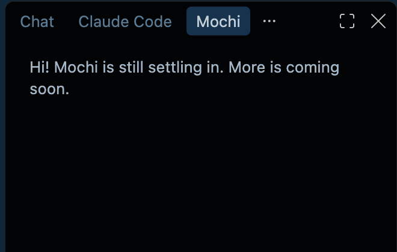
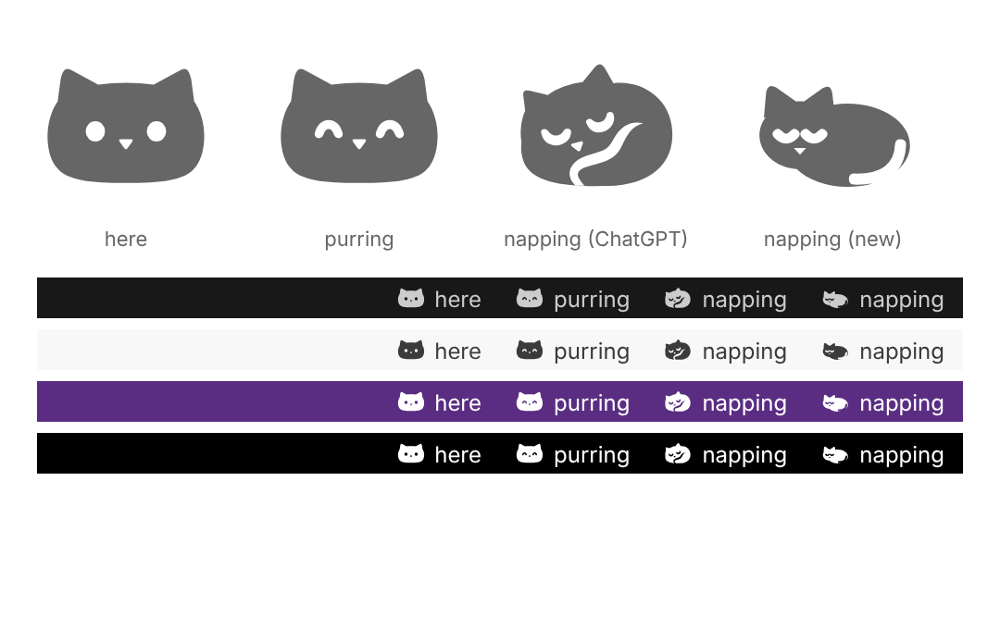

# Design

Every design decision made so far: how Mochi looks, where it appears, how it
talks, and how it asks. The details live in PRESENCE.md, MOMENTS.md, and
PACKS.md; this doc collects the decisions in one place. Still open: the
panel's look, colors, type, and avatar art (see "Not designed yet").

## Principles
- **Any theme:** every part of Mochi must look right in any VS Code theme,
  light, dark, and high contrast. Mochi follows VS Code's theme and never
  brings its own.
- **Cozy and never in the way:** warm and encouraging, never scary or noisy.
- **Original art and voice only.**
- **Words with every icon:** an icon never stands alone, and screen readers
  get plain words, never icon names like `$(mochi-purring)`.
- **Private in what it shows:** prompts show file names, never full paths.
  Personal names stay out of the public repo, in the personal layer.
- **No em dashes** in anything Mochi says or any doc.

## Where Mochi appears
Four places, from always visible to only when it helps (PRESENCE.md, and the
first sketch in [design/presence-sketch.html](design/presence-sketch.html)):
1. **Side panel:** Mochi's home.
2. **Status bar:** the mood line, always there.
3. **Inside the code:** a small hint next to errors.
4. **Gentle nudge:** a small corner card for key moments.

**On the right side:** Mochi's home is a **"Mochi" tab in the secondary side
bar**, next to Chat and Claude Code (last in the row). VS Code shows these
tabs as text labels by default, so the cat icon only shows if she switches to
icons. The cat icon in the left activity bar from the first sketch was
dropped; the tab replaces it.

The right side bar may start closed, so the first-run welcome and a click on
the mood line both open Mochi's tab.

## Status bar mood line
- On the right of the status bar: `$(mochi-purring) Mochi is purring`.
- Tooltip "Open Mochi"; clicking it opens Mochi's tab. Listed as "Mochi mood"
  when someone right-clicks the status bar to hide items.
- Screen readers hear "Mochi is purring. Open Mochi."
- **Moods:** here, purring (the default for now), and napping. Moods from the
  moments and the pack come later.
- **Quiet mode:** napping wins over anything Mochi starts on its own. The
  line shows "Mochi is napping" with the tooltip "Quiet mode. Click to open
  Mochi."
- **Focus session:** "Focusing · 18 min left", in minutes only, never ticking
  seconds. It shows even in quiet mode, since she started it. Clicking it
  offers "Stop the focus session" or "Open Mochi". When time's up: "Time's
  up! That was some focused work. Stretch break?" with "Another round" and
  "Done", also in quiet mode.

## Speak-up levels
Shown in Settings under "Mochi", and settable per project:
- **Quiet:** Mochi stays in the status bar and only talks when you open it.
- **Gentle (default):** Mochi offers help and kind words now and then.
- **Chatty:** Mochi says hello more often, with fun facts and small talk.

Whatever the level, Mochi always answers when she asks.

## Voice and wording
The default lines are in `packs/default/pack.json` (format in PACKS.md).
- **Playful, warm, and a little bit cat:** an occasional "meow", a slow blink,
  a cat fact now and then, only when it fits. Short and kind.
- **A friend, not a textbook:** "we" and "let's", a few sentences and a small
  example, ending with a gentle next step ("Want to try one together?"). At
  most one emoji, and only a cat or paw.
- **Homework is done together, never refused coldly:** "I can't do the whole
  thing for you, but I can do it with you. What's the first part asking?"
  This rule is fixed in code, so no pack can remove it.
- **Celebrate the specific thing:** "Yay, you finished {thing}! That earns a
  slow blink from me."
- **Never corporate, guilty, or lecturing.** A unit test checks the default
  lines for this.
- **Late-night nudge:** once per night, while she's typing, after the late
  hour (a setting, 23:00 by default). A light theme gets the dim offer; dark
  and high contrast themes get a company-only line.
- **Late night is company, not a parent:** "Late-night coding buddy,
  reporting for duty. Cozier theme?" No lectures about water or sleep.
- **Greetings by time of day:** morning, afternoon, or evening. From 23:00
  until 5:00 it's "Hi, night owl!", never "Good night", which sounds like
  goodbye.
- **Her name** is used in greetings only when she has set one, in her
  private personal layer.
- **No anime or pop-culture references in the default pack.** Those belong
  in the personal layer.
- **No counting absence:** after time away, a warm "Welcome back! I missed
  you." or "Oh hi! Good to see you again.", never "It's been 3 days." A unit
  test checks the default lines.
- **The greeting** (once a day, when VS Code opens): a gentle notification
  that fades on its own, until the panel exists. Up to three short
  sentences: "Meow, good evening! Welcome back! I missed you. Back to
  homework-3?" The project line, "Back to {project}?" or "Picking up
  {project} again? I'm ready.", shows only when she opens the project she
  last coded in.

## Prompts and dialogs
- **Sharing:** a modal dialog that names the AI and says exactly what would
  be shared: "Share lines 9 to 15 of homework.py (the error on line 12) with
  Copilot?" Buttons: Share,
  Send without it, and Cancel. Detail line: "Nothing leaves your computer
  unless you choose Share."
- **Secrets:** nothing from `.env` or key files is ever shared, and Mochi
  says why. Text that looks like a password or API key adds "Careful: this
  looks like it might contain a password or API key." to the question.
- **Explaining, on a learning ladder:** "Explain with Mochi" in the lightbulb
  next to an error, or "Mochi: Explain this" on selected code. Explain comes
  first (what it means, why, where to look). Then "Want a hint, or the
  fix?" offers the next steps, only when she picks them. The answer shows in
  the "Mochi" output panel without taking focus from her editor, until the
  panel chat exists.
- **Code hint:** plain "Need a paw?" in italics at the end of the error's
  line, with no emoji (they look different on every system). Its hover
  offers "Explain with Mochi".
- **No brain yet:** one gentle line, only when she asks something: "I'd need a
  brain to answer that. Want to set one up?" with a "Set one up" button. No
  other nagging.
- **Copilot permission:** VS Code shows its own one-time prompt, with Mochi's
  reason: "Mochi uses Copilot to answer the questions you ask it."
- **When a brain can't answer**, Mochi says why kindly, like "This brain is
  resting for now, maybe a usage limit. Try again a bit later."
- **Mochi confirms before doing anything she didn't directly ask for**
  (MOCHI-31). What she starts herself, like a focus session, isn't asked
  again. Offers ask as a gentle notification, never a
  dialog that blocks VS Code: "Want me to dim things with a darker theme?"
  with "Dim things" and "Not now". Closing it means no.
- **Then offer Undo:** "Dimmed! Changed your mind?" with an Undo button that
  puts things back exactly.
- **Nothing to do? Say why instead of asking:** "You're already on a dark
  theme. Cozy!"
- **Never change a high contrast theme.** Someone using one most likely needs
  it.
- **Setting up a Python project:** "Mochi: Set up a Python project" in the
  Command Palette. The steps show in the terminal panel, with "Setting up a
  virtual environment in .venv..." while it works. Then, each asked first:
  "This project lists 3 packages in requirements.txt. Install them too?"
  with "Install" and "Not now", and "This project uses git. Want me to add
  .venv to .gitignore, so it stays out of your commits?" with "Add it". It
  ends with a teaching line and Undo: "Your Python project is all set up in
  .venv! Next time you can do this yourself with python3 -m venv .venv".
- **Offering Python setup on its own:** "This looks like a Python project.
  Want me to set up a virtual environment? It keeps this project's packages
  in their own box." with "Set it up" and "Not now".
- **Why Mochi won't set up:** "This project already has a virtual
  environment (venv). You're all set!", "This project uses Poetry (I spotted
  poetry.lock), so I'll let Poetry handle its environment.", and in
  Restricted Mode, "This folder is in Restricted Mode, so I won't run
  anything in it. If you trust it, you can change that, and then I'd love to
  help." with "Manage Workspace Trust". Without Python: "I couldn't find
  Python on this computer. Want to install it?" with "Get Python". With no
  folder open: "Open your project folder first, and I'll set it up." with
  "Open Folder".
- **Several folders open:** "Which project should I set up?", listing folder
  names only (never paths), with the one she's working in first, marked
  "where you're working now".
- **Remote setups:** "I couldn't find Python in this WSL distro. It needs to
  be installed there, not on your own computer.", plus the apt command on
  Linux. Where there's no Trash, Undo asks "I can't move .venv to the Trash
  here. Delete it for good?" with "Delete it" and "Keep it".
- **When setup goes wrong:** installing shows a Cancel button; stopping says
  "Okay, I stopped installing. Anything that finished is still there." A
  failed install mentions no internet or a restricted network as a common
  reason, and a failed setup on Linux names the python3-venv package.
- **Her name:** "Mochi: What should I call you?" opens an input box ("Your
  name or a nickname"), which explains kindly what's wrong ("That's a little
  long. Up to 30 characters, please."). Then "Nice to meet you, Sam! I'll
  use your name when I say hello." "Mochi: Forget my name" says "Okay, I've
  forgotten your name. You can tell me again anytime."
- **Forget everything:** a dialog, since it can't be undone: "Forget
  everything?" with "This clears your chats, your name and personal touches,
  and everything Mochi remembers about your days. Your settings and any
  saved AI key stay as they are." Buttons: "Forget everything" and "Keep
  it". After: "All clear. It's a fresh start, and I'm still right here."
- **If her personal touches can't be loaded:** "I couldn't load your
  personal touches, so I'm my usual self for now. They're kept safe, not
  deleted." Once per session.
- **Where sentences live:** every sentence above is in `src/strings.ts` (or
  the pack), never inline in code.

## Not designed yet (MOCHI-50)
- **The panel's look:** avatar, greeting, chat, quick buttons ("Explain this",
  "Focus 25 min", "Dark mode"), and the "Ask Mochi anything" box, as in the
  first sketch. No panel UI is built until this is designed.
- **Colors and type.**
- **Avatar art and moods** for the panel (MOCHI-17).
- **The first-run welcome and "Pick a brain"** (MOCHI-42): explain inside
  Mochi's tab first, hand off to VS Code's Copilot setup only when she picks
  it, and confirm "Got a brain! Ask me anything." when it's ready.
- **The gift's "You've got a gift!" screen** (MOCHI-56).

## Icons

*Early versions, before the faces were snapped to the pixel grid. The
"napping (ChatGPT)" pose was replaced by "napping (new)".*

### Style
- **Pillow Loaf:** a soft, solid cat shape, like a loaf of bread.
- **Solid:** one filled shape per icon. The eyes and nose are cut-outs, so
  they take the background color.
- **One pose per mood:** here (eyes open), purring (happy closed eyes), and
  napping (curled up asleep).

### How they were made
- **here and purring:** explored with ChatGPT.
- **napping:** redrawn by Claude for 16px readability.
- **All three:** converted to nonzero winding by Claude, so the cut-outs
  survive icon-font tools.
- **Facial features snapped to the 16px pixel grid by Claude**, after the
  built-font test showed blurry holes at 1x. In that redraw, napping's body
  also moved about half a pixel to the right.
- The first versions carried C2PA content credentials. The grid-snapped
  redraws don't.

### How they're tested
The built font is tested, not the SVGs. Each glyph is rendered at 16px, at 1x
and 2x, on dark (`#181818`) and light (`#f8f8f8`) backgrounds. An icon passes
only if the eyes and nose show as clean holes, the three moods are clearly
different, and nothing is clipped, at both 1x and 2x.

### Files
- `media/icons/`: the source SVGs. One path each, 16x16, `currentColor`.
- `media/font/mochi-icons.woff`: the built font. Rebuild it with
  `npm run build:icons` after changing an SVG, and commit it.
- `.fantasticonrc.js`: the font settings. Same grid as VS Code's own icons
  (300 units, on the baseline), and fixed character numbers: here `E001`,
  purring `E002`, napping `E003`. Never renumber them; a new mood takes the
  next free number.
- `package.json` registers each mood under `contributes.icons`, so text can
  use it as `$(mochi-purring)`. A unit test checks that these numbers match
  the font settings.

### Where they're used
- **Status bar:** `$(mochi-purring) Mochi is purring`.
- **Mochi's tab in the secondary side bar:** `media/icons/mochi-here.svg`.
