# Design

Every design decision made so far: how Mochi looks, where it appears, how it
talks, and how it asks. The details live in PRESENCE.md, MOMENTS.md, and
PACKS.md; this doc collects the decisions in one place. Still open: the
panel's look, colors, type, and avatar art (see "Not designed yet").

## Principles
- **Any theme:** every part of Mochi must look right in any VS Code theme,
  light, dark, and high contrast. Mochi follows VS Code's theme, adds only
  a few warm colors in light and dark themes (MOCHI-50), and never touches
  high contrast. Text is always the theme's own color.
- **Cozy and never in the way:** warm and encouraging, never scary or noisy.
- **Original art and voice only.**
- **Words with every icon:** an icon never stands alone, and screen readers
  get plain words, never icon names like `$(mochi-purring)`. Two exceptions,
  like other chat boxes: the send arrow inside the panel's box, with "Send"
  as its tooltip and what screen readers say (a stop square with "Stop"
  while Mochi answers), and the x on the attachment chip, with "Leave out
  homework.py, lines 9 to 15".
- **Private in what it shows:** prompts show file names, never full paths.
  Personal names stay out of the public repo, in the personal layer.
- **No em dashes** in anything Mochi says or any doc.

## Where Mochi appears
Four places, from always visible to only when it helps (PRESENCE.md, and the
first sketch in [design/presence-sketch.html](design/presence-sketch.html)):
1. **Side panel:** Mochi's home.
2. **Status bar:** the mood line, always there.
3. **Inside the code:** a small hint next to errors.
4. **Gentle nudge:** a small corner card for key moments.

**On the right side:** Mochi's home is a **"Mochi" tab in the secondary side
bar**, next to Chat and Claude Code (last in the row). VS Code shows these
tabs as text labels by default, so the cat icon only shows if she switches to
icons. The cat icon in the left activity bar from the first sketch was
dropped; the tab replaces it.

The right side bar may start closed, so the first-run welcome and a click on
the mood line both open Mochi's tab.

## Status bar mood line
- On the right of the status bar: `$(mochi-purring) Mochi is purring`.
- Tooltip "Open Mochi"; clicking it opens Mochi's tab. Listed as "Mochi mood"
  when someone right-clicks the status bar to hide items.
- Screen readers hear "Mochi is purring. Open Mochi."
- **Moods:** here, purring (the default for now), and napping. Moods from the
  moments and the pack come later.
- **Quiet mode:** napping wins over anything Mochi starts on its own. The
  line shows "Mochi is napping" with the tooltip "Quiet mode. Click to open
  Mochi."
- **Focus session:** "Focusing · 18 min left", in minutes only, never ticking
  seconds. It shows even in quiet mode, since she started it. Clicking it
  offers "Stop the focus session" or "Open Mochi". When time's up: "Time's
  up! That was some focused work. Stretch break?" with "Another round" and
  "Done", also in quiet mode.
- **Break** (MOCHI-36): "Break · 4 min left", with the purring cat, after
  she taps "Take a break" under a celebration. Tooltip "Break time. Click
  to open Mochi." Shows in quiet mode too, and ends with "Break's over!
  Ready when you are."

## Speak-up levels
Shown in Settings under "Mochi", and settable per project:
- **Quiet:** Mochi stays in the status bar and only talks when you open it.
- **Gentle (default):** Mochi offers help and kind words now and then.
- **Chatty:** Mochi says hello more often, with fun facts and small talk.

Whatever the level, Mochi always answers when she asks.

## Voice and wording
The default lines are in `packs/default/pack.json` (format in PACKS.md).
- **Playful, warm, and a little bit cat:** an occasional "meow", a slow blink,
  a cat fact now and then, only when it fits. Short and kind.
- **A friend, not a textbook:** "we" and "let's", a few sentences and a small
  example, ending with a gentle next step ("Want to try one together?"). At
  most one emoji, and only a cat or paw.
- **Homework is done together, never refused coldly:** "I can't do the whole
  thing for you, but I can do it with you. What's the first part asking?"
  This rule is fixed in code, so no pack can remove it.
- **Celebrate the specific thing:** "Yay, you finished {thing}! That earns a
  slow blink from me." With nothing to name: "Yay, you did it! That earns a
  slow blink from me." Chips under it: "Check my work", "Take a break", and
  on a light theme "Switch to a dark theme". With nothing selected, Check
  my work says "Select the code you'd like me to check, then tap Check my
  work again." Never for frustration ("done, I give up"), see MOMENTS.md.

  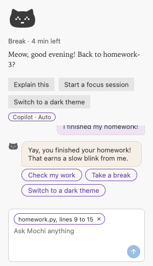

  *A preview rendered in Chrome with Light Modern's colors, not a screenshot
  of VS Code.*
- **Never corporate, guilty, or lecturing.** A unit test checks the default
  lines for this.
- **Late-night nudge:** once per night, while she's typing, after the late
  hour (a setting, 23:00 by default). A light theme gets the dim offer; dark
  and high contrast themes get a company-only line.
- **Late night is company, not a parent:** "Late-night coding buddy,
  reporting for duty. Cozier theme?" No lectures about water or sleep.
- **Greetings by time of day:** morning, afternoon, or evening. From 23:00
  until 5:00 it's "Hi, night owl!", never "Good night", which sounds like
  goodbye.
- **Her name** is used in greetings only when she has set one, in her
  private personal layer.
- **No anime or pop-culture references in the default pack.** Those belong
  in the personal layer.
- **No counting absence:** after time away, a warm "Welcome back! I missed
  you." or "Oh hi! Good to see you again.", never "It's been 3 days." A unit
  test checks the default lines.
- **The greeting** (once a day, when VS Code opens): at the top of Mochi's
  panel, the same line all day (MOCHI-16). A gentle notification that fades
  on its own only when the panel isn't visible. Up to three short
  sentences: "Meow, good evening! Welcome back! I missed you. Back to
  homework-3?" The project line, "Back to {project}?" or "Picking up
  {project} again? I'm ready.", shows only when she opens the project she
  last coded in.

## Mochi's panel (MOCHI-16)
The "Mochi" tab, with VS Code's theme and the preview look below
(MOCHI-50). Illustrated art comes after the preview (MOCHI-17).
- **At the top:** the cat (the status bar's mood icon from Mochi's icon
  font, 56px, in the theme's text color, switching with the mood: here,
  purring, napping), the mood in words ("Mochi is purring", "Mochi is
  napping", "Focusing · 18 min left"), and today's greeting, the same line
  all day. On her first day, the welcome, with its button.
- **Quick buttons**, each with the same name as the command it runs, so she
  learns one name: "Explain this", "Start a focus session" (or "Stop the
  focus session" while one runs), and "Switch to a dark theme". "Explain
  this" explains the selected code, or the error under the cursor (or the
  first in the file); with neither: "Select some code, or click on an
  error, and I'll explain it."
- **At the bottom:** a box, "Ask Mochi anything" (the name from the pack):
  one rounded frame that grows as she types, with a round send arrow inside
  it at the bottom right, in the theme's button color, faded until there's
  something to send. Enter sends, Shift+Enter adds a line. Selected code goes
  through the share gate, and text that looks like a password or API key
  gets "Careful: this looks like it might contain a password or API key.
  Send anyway?" first. What she typed comes back if it couldn't be sent,
  and an unsent draft survives the panel closing.
- **The chat** (MOCHI-21), between the buttons and the box, the only part
  that scrolls. Her messages on the right, exactly as she typed them;
  Mochi's on the left, with the little cat beside each. What she clicked
  shows as her side too: "Explain the error on line 12 of homework.py",
  "Explain the selected code from homework.py", "Give me a hint". Answers
  are formatted (bold, lists, inline code), code blocks use the editor's
  font with a "Copy" button above them ("Copied" after), and links show
  their domain, like "Python tutorial (docs.python.org)". Next steps are
  chips under the answer, and a problem is Mochi's message with a warning
  border and a chip. When it's empty: "Our chat stays on this computer. It
  can include code from our conversation; Clear chat removes it." In a
  remote window it names the machine: "on this SSH machine", "in this WSL
  distro", "in this container", "in this codespace".
- **The brain at the top of the chat** (MOCHI-21): a small rounded button in
  quiet text, "Copilot · Auto", or "Choose a brain" when Mochi would ask
  first. One click opens Choose a brain. Screen readers hear "Copilot ·
  Auto. Choose a brain".
- **What was shared:** under her message, in quiet text, "shared lines 9 to
  15 of homework.py". Saved with the chat, never the code.
- **The attachment chip:** while she has code selected, a rounded chip at
  the top of the box, "homework.py, lines 9 to 15", with an x that leaves it
  out until she selects something else. The x's tooltip and screen reader
  label: "Leave out homework.py, lines 9 to 15".
- **"Clear chat"** in the ... menu of Mochi's tab (and "Mochi: Clear chat"):
  a dialog, "Clear this chat?" with "This can't be undone.", "Clear" and
  "Keep it". An empty chat isn't asked about.
- **If the chat can't be saved**, once per session, as Mochi's message: "I
  couldn't save our chat on this computer, so it lasts until VS Code
  closes." (with the machine's name in a remote window).
- **While Mochi answers** (MOCHI-25): three small paw prints in the empty
  bubble, in quiet text, brightening in turn like little steps (still with
  Reduce Motion). The round send button shows a stop square, "Stop", and
  Escape stops too. A stopped answer ends with "Stopped" in quiet italics.
  No notification.
- **Keyboard and screen readers:** real buttons and a labelled box, focus
  outlines in the theme's focus color, and the greeting and hints announced
  politely. Each of Mochi's messages is announced once when it's done: the
  cat's name, then the text, with code blocks named ("Code block, 3
  lines"), and "Stopped." for a stopped answer. Answer bubbles can take
  focus. High contrast themes get borders on buttons.

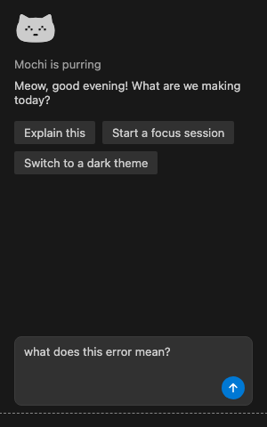
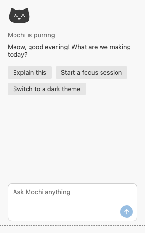

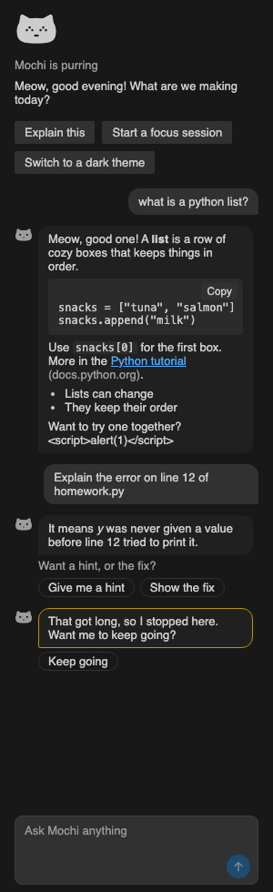
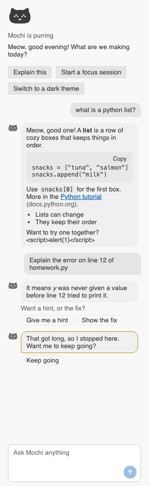

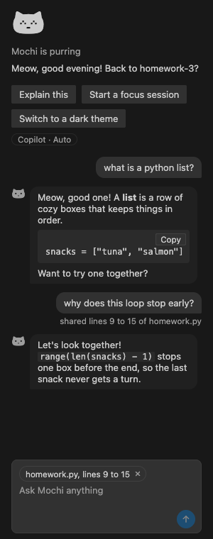
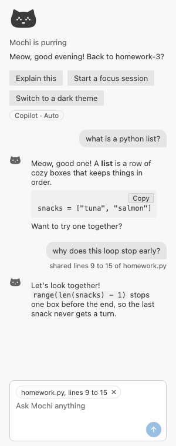

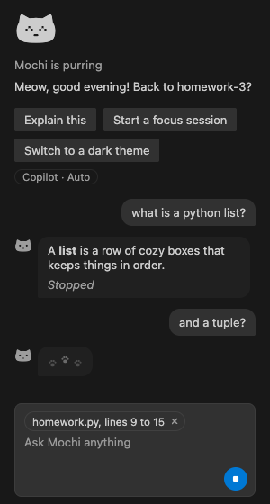
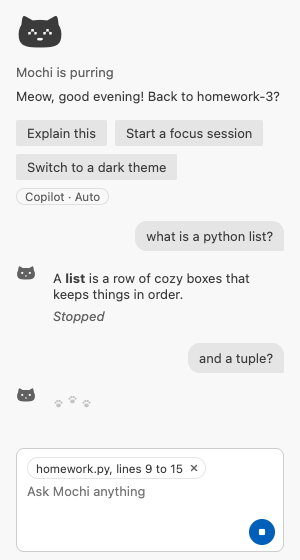

*Previews rendered in Chrome with Dark Modern's and Light Modern's colors
filled in for VS Code's theme variables, not screenshots of VS Code itself.
The chat previews use the panel's real script and stylesheet with a sample
conversation, including a hostile `<script>` shown as plain text.*

## Prompts and dialogs
- **Sharing:** a modal dialog that names the AI and says exactly what would
  be shared: "Share lines 9 to 15 of homework.py (the error on line 12) with
  Copilot?" Buttons: Share,
  Send without it, and Cancel. Detail line: "Nothing leaves your computer
  unless you choose Share."
- **Secrets:** nothing from `.env` or key files is ever shared, and Mochi
  says why. Text that looks like a password or API key adds "Careful: this
  looks like it might contain a password or API key." to the question.
- **Explaining, on a learning ladder:** "Explain with Mochi" in the lightbulb
  next to an error (or a warning that crashes, like an undefined name), or "Mochi: Explain this" on selected code. Explain comes
  first (what it means, why, where to look). Then "Want a hint, or the
  fix?" offers the next steps as chips, only when she picks them. The answer
  shows in the chat in Mochi's panel, without taking focus from her editor.
- **Learning mode** (Settings, under Mochi, on by default): "Help me learn
  instead of handing me answers. For homework, your code, and errors, Mochi
  explains first, gives a hint if you ask, and shows the fix only when you
  ask for it. Turn off for direct answers, fixes included. Only you can
  change this; a project's settings can't." With it off, "Explain with
  Mochi" explains briefly and shows the fix right away.
- **Code hint:** plain "Need a paw?" in italics at the end of the error's
  line, with no emoji (they look different on every system). Its hover
  offers "Explain with Mochi".
- **No brain yet:** one gentle line, only when she asks something: "I'd need a
  brain to answer that. Want to set one up?" with a "Set one up" button. No
  other nagging. "Set one up" opens Copilot's setup, or Choose a brain in
  editors that don't have it.
- **Copilot permission:** VS Code shows its own one-time prompt, with Mochi's
  reason, naming the brain: "Mochi uses Copilot · Auto to answer the
  questions you ask it."
- **Choosing a brain:** "Mochi: Choose a brain" opens "Which brain should
  Mochi think with?", with "Uses your Copilot plan" as a quiet line. First
  "Let Mochi choose" (described as "Now: Copilot · Auto"), then each brain
  ("Copilot · GPT-5.6 Luna"), the one in use marked with a check. With no
  brains: "Sign in to GitHub Copilot". After a pick: "Got it. I'll think
  with Copilot · GPT-5.6 Luna from now on."
- **Her Claude models in that list:** shown by name ("Claude Haiku 4.5"),
  with "your key · billed per use" as a quiet line. While no key is saved,
  the list ends with "Add a Claude key". "Sign in to GitHub Copilot" only
  appears in editors that have Copilot's setup.
- **Adding a Claude key:** "Mochi: Add a Claude key" opens a dialog, "Add a
  Claude key", with: "Mochi can think with Claude using your own API key
  from the Claude Console. Each answer is billed to your Claude account,
  per use. A Claude Pro or Max subscription can't be used here; it only
  works in Claude's own apps." and "Tip: you can set a monthly spend limit
  in the Claude Console." (plus "This replaces the Claude key Mochi has
  now." when there is one). Buttons: "Get a key" (opens the Console, then
  the box) and "I have a key". The box hides what she types and says
  "Paste your Claude API key. Mochi keeps it in your system's keychain,
  never in settings or files." While checking: "Checking your key with
  Claude...". If it doesn't work: "That key didn't work. Check that you
  copied all of it, or make a new one in the Claude Console." with "Try
  again" and "Get a key". Offline: "I couldn't reach Claude to check your
  key. Are we offline? Your key isn't saved yet." With no keychain: "I
  couldn't save your key, because this computer doesn't have a keychain
  Mochi can use. Your key isn't kept." with "How to fix this".
- **Which Claude model:** right after the key checks out, "Which Claude
  model should Mochi use?" with "Each answer is billed to your Claude
  account." Haiku 4.5 comes first, with "Good starting point for
  explanations". After a pick, the usual "Got it. I'll think with Claude
  Haiku 4.5 from now on." Closing it: "Your Claude key is saved. Mochi:
  Choose a brain picks a Claude model whenever you're ready."
- **Removing it:** a dialog, "Remove your Claude key?", with "Mochi forgets
  it on this computer. The key still works until you delete it in the
  Claude Console." Buttons: "Remove" and "Keep it". After: "Done. Mochi
  doesn't have your Claude key anymore."
- **When Claude can't answer:** one kind line per problem, with "Add a
  Claude key" for a key that stopped working and "Open the Claude Console"
  for billing and the general line (the full table is in CHAT.md,
  section 5).
- **An answer that reached the length limit** (her Claude key only): what
  was written stays, then a gentle note, "That got long, so I stopped here.
  Want me to keep going?", with "Keep going", which continues the same
  answer.
- **When she closes the list without picking:** "I'll think once you pick a
  brain. Mochi: Choose a brain whenever you're ready."
- **A stand-in brain:** at the top of her next answer, once per change:
  "Quick note: GPT-5.6 Luna isn't available right now, so I'm thinking with
  Copilot · Auto instead. Mochi: Choose a brain changes this."
- **When a brain can't answer**, Mochi says why kindly, like "This brain is
  resting for now, maybe a usage limit. Try again a bit later."
- **Mochi confirms before doing anything she didn't directly ask for**
  (MOCHI-31). What she starts herself, like a focus session, isn't asked
  again. Offers ask as a gentle notification, never a
  dialog that blocks VS Code: "Want me to switch to a dark theme?" with
  "Switch to a dark theme" and "Not now". Closing it means no. The button
  uses the same name as the command it runs ("Mochi: Switch to a dark
  theme"), so she learns one name (renamed from "Dim things" in MOCHI-16).
- **Then offer Undo:** "Switched to a dark theme. Changed your mind?" with
  an Undo button that puts things back exactly.
- **Nothing to do? Say why instead of asking:** "You're already on a dark
  theme. Cozy!"
- **Never change a high contrast theme.** Someone using one most likely needs
  it.
- **Setting up a Python project:** "Mochi: Set up a Python project" in the
  Command Palette. The steps show in the terminal panel, with "Setting up a
  virtual environment in .venv..." while it works. Then, each asked first:
  "This project lists 3 packages in requirements.txt. Install them too?"
  with "Install" and "Not now", and "This project uses git. Want me to add
  .venv to .gitignore, so it stays out of your commits?" with "Add it". It
  ends with a teaching line and Undo: "Your Python project is all set up in
  .venv! Next time you can do this yourself with python3 -m venv .venv".
- **Offering Python setup on its own:** "This looks like a Python project.
  Want me to set up a virtual environment? It keeps this project's packages
  in their own box." with "Set it up" and "Not now".
- **Why Mochi won't set up:** "This project already has a virtual
  environment (venv). You're all set!", "This project uses Poetry (I spotted
  poetry.lock), so I'll let Poetry handle its environment.", and in
  Restricted Mode, "This folder is in Restricted Mode, so I won't run
  anything in it. If you trust it, you can change that, and then I'd love to
  help." with "Manage Workspace Trust". Without Python: "I couldn't find
  Python on this computer. Want to install it?" with "Get Python". With no
  folder open: "Open your project folder first, and I'll set it up." with
  "Open Folder".
- **Several folders open:** "Which project should I set up?", listing folder
  names only (never paths), with the one she's working in first, marked
  "where you're working now".
- **Remote setups:** "I couldn't find Python in this WSL distro. It needs to
  be installed there, not on your own computer.", plus the apt command on
  Linux. Where there's no Trash, Undo asks "I can't move .venv to the Trash
  here. Delete it for good?" with "Delete it" and "Keep it".
- **When setup goes wrong:** installing shows a Cancel button; stopping says
  "Okay, I stopped installing. Anything that finished is still there." A
  failed install mentions no internet or a restricted network as a common
  reason, and a failed setup on Linux names the python3-venv package.
- **Her name:** "Mochi: What should I call you?" opens an input box ("Your
  name or a nickname"), which explains kindly what's wrong ("That's a little
  long. Up to 30 characters, please."). Then "Nice to meet you, Sam! I'll
  use your name when I say hello." "Mochi: Forget my name" says "Okay, I've
  forgotten your name. You can tell me again anytime."
- **Forget everything:** a dialog, since it can't be undone: "Forget
  everything?" with "This clears your chats, your name and personal touches,
  and everything Mochi remembers about your days. Your settings and any
  saved AI key stay as they are." Buttons: "Forget everything" and "Keep
  it". After: "All clear. It's a fresh start, and I'm still right here."
- **If her personal touches can't be loaded:** "I couldn't load your
  personal touches, so I'm my usual self for now. They're kept safe, not
  deleted." Once per session.
- **First-run welcome** (MOCHI-42, small version): Mochi's tab opens once,
  and the top of the panel says (a notification if the panel doesn't
  open) "Meow, hi! I'm Mochi, your coding buddy.
  I live in the Mochi tab, and my mood shows in the status bar." (the cat's
  name comes from the pack), then one of:
  - a brain is ready: "I can think with Copilot · Auto whenever you ask me
    something.";
  - no brain: "To answer questions I need a brain, and GitHub Copilot's free
    plan works: just sign in with GitHub." with "Set up Copilot";
  - no brain and no Copilot setup in the editor: "To answer questions I need
    a brain. Choose a brain shows what you can use." with "Choose a brain";
  - brains but none chosen yet: nothing more.
  Once Copilot is ready after she set it up from Mochi, Mochi brings her
  back to its tab (VS Code's setup leaves its own Chat view in front) and
  says "Got a brain! Ask me anything." in the panel, and the welcome line
  now names the brain.
- **Where sentences live:** every sentence above is in `src/strings.ts` (or
  the pack), never inline in code.

## The preview look (MOCHI-50, decided 2026-10-10)
Warm and cozy, on top of VS Code's theme. **Illustrated art comes after the
preview** (MOCHI-17): until then the avatar is the icon font's cat.

- **Avatar and moods:** the Pillow Loaf cat from Mochi's icon font, 56px at
  the top of the panel, switching with the mood (here, purring, napping).
  The same cat, small, beside each of Mochi's messages.
- **Colors:** all in the one token block at the top of
  `media/panel/panel.css`, scoped by the theme class VS Code gives the
  panel. Raw colors appear nowhere else (a unit test checks).

  | Token | Light themes (`vscode-light`) | Dark themes (`vscode-dark`) |
  |---|---|---|
  | `--mochi-reply-bubble` (Mochi's bubble) | `#F6EFE6` warm cream | `#2E2533` deep plum |
  | `--mochi-her-bubble` (her bubble) | `#EDE4F7` lavender | `#3B2D4A` |
  | `--mochi-accent` (chips, links, the box's frame while she types, paw prints) | `#6B3FA0` plum | `#C3A6E8` lilac |
  | `--mochi-bubble-border` (soft 1px border) | `#E2D6C8` | `#4A3C57` |

  High contrast themes, dark and light, get no colors of their own: every
  token stays a theme variable. Text is always the theme's foreground.
- **Contrast:** every text and background pair meets WCAG AA (4.5:1) in
  Light Modern and Dark Modern, checked by a unit test. Lowest: quiet text
  on Mochi's bubble in Dark Modern, 5.42:1. Paw prints meet 3:1.
- **Type:** the greeting line alone has a vintage touch, in "Iowan Old
  Style" (on every Mac), then Georgia, then serif. No downloaded fonts.
- **Cozy details, CSS only:** rounded 12px bubbles with a small tail, more
  padding (8px 12px), a soft 1px border, and chips, the brain, the
  attachment chip, and Copy as pills.

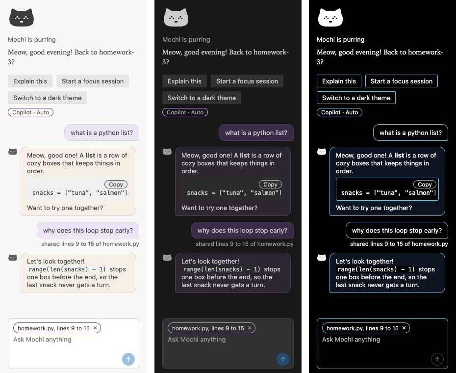
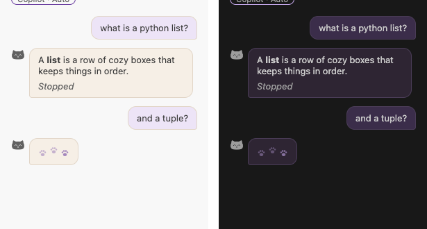

*Previews rendered in Chrome with the themes' colors filled in for VS
Code's theme variables, not screenshots of VS Code itself. The earlier
previews above show the panel before this look.*

## Not designed yet
- **Illustrated avatar art and moods** (MOCHI-17), after the preview.
- **A fuller "Pick a brain"** inside Mochi's tab, after the small welcome
  (MOCHI-42): explain first, hand off to VS Code's Copilot setup only when
  she picks it.
- **The gift's "You've got a gift!" screen** (MOCHI-56).

## Icons

*Early versions, before the faces were snapped to the pixel grid. The
"napping (ChatGPT)" pose was replaced by "napping (new)".*

### Style
- **Pillow Loaf:** a soft, solid cat shape, like a loaf of bread.
- **Solid:** one filled shape per icon. The eyes and nose are cut-outs, so
  they take the background color.
- **One pose per mood:** here (eyes open), purring (happy closed eyes), and
  napping (curled up asleep).

### How they were made
- **here and purring:** explored with ChatGPT.
- **napping:** redrawn by Claude for 16px readability.
- **All three:** converted to nonzero winding by Claude, so the cut-outs
  survive icon-font tools.
- **Facial features snapped to the 16px pixel grid by Claude**, after the
  built-font test showed blurry holes at 1x. In that redraw, napping's body
  also moved about half a pixel to the right.
- The first versions carried C2PA content credentials. The grid-snapped
  redraws don't.

### How they're tested
The built font is tested, not the SVGs. Each glyph is rendered at 16px, at 1x
and 2x, on dark (`#181818`) and light (`#f8f8f8`) backgrounds. An icon passes
only if the eyes and nose show as clean holes, the three moods are clearly
different, and nothing is clipped, at both 1x and 2x.

### Files
- `media/icons/`: the source SVGs. One path each, 16x16, `currentColor`.
- `media/font/mochi-icons.woff`: the built font. Rebuild it with
  `npm run build:icons` after changing an SVG, and commit it.
- `.fantasticonrc.js`: the font settings. Same grid as VS Code's own icons
  (300 units, on the baseline), and fixed character numbers: here `E001`,
  purring `E002`, napping `E003`. Never renumber them; a new mood takes the
  next free number.
- `package.json` registers each mood under `contributes.icons`, so text can
  use it as `$(mochi-purring)`. A unit test checks that these numbers match
  the font settings.

### Where they're used
- **Status bar:** `$(mochi-purring) Mochi is purring`.
- **Mochi's tab in the secondary side bar:** `media/icons/mochi-here.svg`.
